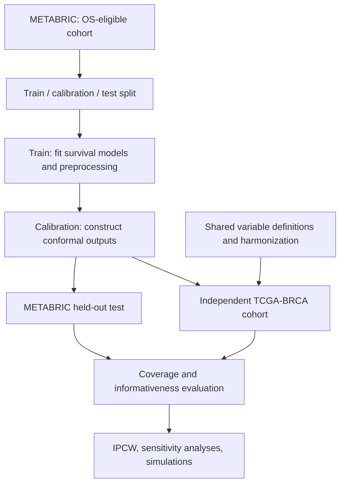

<div align="center">

# Conformal Survival Prediction Under Distribution Shift

**Censoring-aware calibration · Cross-cohort validation · Reproducible survival analysis**

[](https://www.python.org/)
[](#research-overview)
[](#data-and-study-populations)
[](LICENSE)

**Can a survival prediction method remain informative and well calibrated when outcomes are right-censored and the patient population changes?**

This repository documents a research workflow for evaluating **censoring-aware conformal survival prediction**, with an emphasis on **coverage, informativeness, and transportability** from METABRIC to an independent TCGA-BRCA cohort.

[Research overview](#research-overview) · [Study design](#study-design) · [Reproducibility](#reproducing-the-analysis) · [Interpretation](#how-to-interpret-the-results)

</div>

> **Repository status — public release in preparation.** The repository initially contains project documentation, the MIT license, and `.gitignore`. Research notebooks, a tested dependency specification, and curated tables/figures are being prepared for upload. Until those files are present, the setup instructions below describe the *intended reproducible workflow*, not a runnable one-command release. No performance figures are asserted here without the accompanying results files.

## Research overview

Standard survival models estimate risk or survival functions, but a point estimate alone does not communicate the uncertainty of an individual's event time. Conformal prediction offers a calibration-based framework for uncertainty quantification. Applying it to survival outcomes is challenging because **right censoring hides the actual event times for some patients**; deploying predictions in a new cohort introduces an additional challenge through **distribution shift**.

The project investigates three connected questions:

1. **Validity:** How do conformal survival procedures behave when event times are right-censored?
2. **Informativeness:** How much predictive information is retained in the resulting survival bounds or prediction sets?
3. **Transportability:** What happens to empirical performance when a procedure developed in METABRIC is evaluated in an independent TCGA-BRCA population?

The **primary endpoint is overall survival (OS)**. The analysis considers both internal held-out evaluation and external validation, supported by simulation and sensitivity analyses.

## Data and study populations

| Component | Dataset | Role | Cohort size / notes |
|---|---|---|---|
| Development | [METABRIC (cBioPortal)](https://www.cbioportal.org/study/summary?id=brca_metabric) | Model fitting and conformal calibration | 2,509 source records; **1,981** with usable OS time/status in the initial analysis |
| Internal evaluation | METABRIC | Held-out assessment | From the OS-eligible cohort: **1,188 training / 396 calibration / 397 test** observations |
| External evaluation | [TCGA-BRCA, PanCancer Atlas (cBioPortal)](https://www.cbioportal.org/study/summary?id=brca_tcga_pan_can_atlas_2018) | Cross-cohort transportability assessment | 1,084 source patients; analysis eligibility and shared-variable harmonization must be applied before evaluation |

**Outcome definition:** OS follow-up time and event indicator are interpreted jointly. An observed follow-up time for a censored patient is **not** treated as the patient's true event time. Records missing required OS time or status are not automatically reclassified as censored; the exclusion rules and their consequences must be documented.

**External validation means external data.** Subdivisions within METABRIC do not constitute an independent cohort. The TCGA-BRCA analysis is used to examine cross-cohort generalization, with predictor harmonization restricted to variables available and comparably defined in both sources.

### Data access and governance

- Obtain the relevant clinical files from the linked study pages, subject to each source's terms and access requirements.
- Keep patient-level or otherwise restricted source files **outside version control**. Only redistribute data where the corresponding terms permit it.
- Document source study identifiers, download dates, field mappings, exclusion rules, and any local data transformations alongside the released code.
- The repository's **MIT license covers the original code**, not third-party datasets.

## Study design



### Modeling and calibration components

| Component | Purpose |
|---|---|
| **Random Survival Forests (RSF)** | Survival modeling with clinical and extended predictor configurations |
| **Naive calibration** | Project baseline for comparison |
| **Focused and Fused calibration** | Study-specific conformal calibration variants examined against the baseline |
| **Censoring-aware evaluation** | Empirical evaluation using inverse-probability-of-censoring weighting (IPCW), including censoring-model sensitivity checks |
| **Transportability analysis** | Evaluate the trained/calibrated procedure on TCGA-BRCA without reusing external outcomes for model selection |
| **Simulation benchmarks** | Controlled experiments examining censoring and shift, including weighted variants and a DR-COSARC comparison |

**Methodological scope:** The labels *Naive*, *Focused*, and *Fused* refer to procedures in this research workflow; they should not be interpreted as interchangeable with every method bearing a similar name in the literature. Precise definitions, statistical assumptions, and literature attributions belong in the released methodology notebook and manuscript.

### Leakage-prevention principles

- Split patients into training, calibration, and test partitions **before** fitting learned preprocessing or predictive components.
- Fit imputation, encoders, feature transformations, and the survival model on the **training partition only**, unless a method explicitly requires a different and justified scheme.
- Use calibration records to estimate calibration quantities; preserve the held-out test set for evaluation.
- Do **not** tune models, choose thresholds, or select features using test or external-validation outcomes.
- Check feature availability at the prediction time of interest; exclude post-outcome or otherwise unavailable information.
- Report random seeds, split identifiers, evaluation horizons, censoring assumptions, and eligibility criteria so that numerical results can be reproduced.

## Evaluation framework

The analyses distinguish **coverage** from **informativeness**: a very wide bound may cover more event times without being useful for clinical interpretation.

| Evaluation aspect | What is examined |
|---|---|
| Empirical coverage | Agreement between the nominal target and estimated coverage under an explicitly stated estimand |
| Informativeness | Tightness or usefulness of the produced survival bounds / sets |
| Censoring | Sensitivity to marginal versus conditional censoring models and IPCW instability |
| Distribution shift | Changes in coverage and informativeness between held-out METABRIC and independent TCGA-BRCA |
| Simulation | Repeated controlled experiments to assess behavior under known data-generating settings |

> **Important statistical distinction:** Empirical IPCW coverage is an estimate that depends on censoring assumptions and weight estimation. It is not, by itself, a proof of finite-sample coverage under arbitrary censoring or arbitrary distribution shift. A good internal result does not guarantee external validity.

## Reproducing the analysis

### 1. Clone the repository

```bash
git clone https://github.com/ali-maroosi/conformal-survival-transportability.git
cd conformal-survival-transportability
```

### 2. Prepare Python

Once the tested `requirements.txt` and research notebooks have been committed, create an isolated environment:

```bash
python -m venv .venv
```

Activate it on **Windows (PowerShell)**:

```powershell
.venv\Scripts\Activate.ps1
```

Or on **macOS/Linux**:

```bash
source .venv/bin/activate
```

Then install the released dependencies and launch Jupyter:

```bash
python -m pip install -r requirements.txt
jupyter lab
```

**Current limitation:** `requirements.txt` and the analysis notebooks are **not included in the initial GitHub commit shown above**. These commands cannot complete the analysis until the actual code, tested environment, and required file inputs are uploaded. The final release will document tested Python/package versions rather than guessing them.

### 3. Obtain and prepare the data

Download the METABRIC and TCGA-BRCA clinical files through the source links above. Follow the input paths and filenames specified in the uploaded notebooks. The initial METABRIC exploratory notebook uses the clinical TSV named `brca_metabric_clinical_data.tsv`; its original version expects that file alongside the notebook.

Do not interpret missing event times as right-censoring. Confirm OS time units, event coding, patient identifiers, predictor definitions, and eligibility before running survival analyses.

### 4. Run the analysis in this order

1. **Data audit:** inspect missingness, outcome coding, follow-up, event indicators, and cohort eligibility.
2. **Internal development:** create reproducible patient-level partitions and train the Clinical/Extended RSF configurations.
3. **Calibration:** apply the study's Naive, Focused, and Fused procedures using the designated calibration data.
4. **Held-out evaluation:** estimate coverage and informativeness on the untouched METABRIC test partition.
5. **External validation:** harmonize shared features and evaluate the fixed procedure on independent TCGA-BRCA patients; do not tune on external outcomes.
6. **Robustness analyses:** run IPCW/censoring sensitivity checks, simulations, and method comparisons.
7. **Outputs:** regenerate the manuscript's summary tables and figures from saved analysis outputs.

The actual notebook filenames, execution order, seeds, file manifests, and expected output checksums will be linked here when the code release is complete.

## Planned repository layout

The following is the **target organization**, not a claim that every directory or file already exists:

```text
conformal-survival-transportability/
├── README.md
├── LICENSE
├── .gitignore
├── requirements.txt             # to be added after environment verification
├── notebooks/                   # original, ordered analysis notebooks
├── data/
│   └── README.md                # data access and input-file documentation
├── results/
│   ├── tables/                  # curated, non-sensitive summary tables
│   └── figures/                 # final paper figures
└── docs/
    └── methodology.md           # methods, assumptions and provenance
```

The notebook files will be kept under their actual reproducible names, with links added here after publication. Generated datasets and raw patient-level files should not be committed merely to populate the directory tree.

## How to interpret the results

When reviewing the forthcoming tables and figures:

- Compare each method with the **same target coverage level**, endpoint, and evaluation protocol.
- Report **coverage and informativeness together**; neither metric is sufficient on its own.
- Distinguish **internal hold-out performance** from **independent external validation**.
- Interpret IPCW estimates in light of the assumed censoring mechanism, positivity, and potential unstable weights.
- Treat **oracle-weight simulation settings** as controlled benchmarks, not procedures available for real-world patient prediction.
- Avoid presenting an observed empirical coverage percentage as a universal guarantee of validity under dataset shift.

## Reproducibility and release checklist

- [x] Research question and primary endpoint documented
- [x] METABRIC cohort audit and OS-eligible sample identified
- [x] Internal train / calibration / test framework specified
- [x] Independent TCGA-BRCA validation included in the research workflow
- [ ] Publish cleaned, executable notebooks
- [ ] Publish tested dependency versions and execution instructions
- [ ] Add exact data dictionary, file manifest, and preprocessing rules
- [ ] Add run-level seed/split information and curated paper figures/tables
- [ ] Verify end-to-end re-execution from a clean environment
- [ ] Add manuscript citation / DOI when available

Checklist items describe **repository publication status**, not whether the underlying research experiments have been explored privately.

## Citation

If this repository informs your research, please cite the software repository until a formal manuscript citation becomes available:

> Maroosi, A. *Conformal Survival Transportability* [software]. GitHub. https://github.com/ali-maroosi/conformal-survival-transportability

A version-specific citation and manuscript reference will be added when a citable release is archived.

## License

Original repository code is licensed under the [MIT License](LICENSE). Source datasets remain subject to their respective providers' conditions.

---

<div align="center">

**Reliable survival prediction requires more than accurate risk scores: it requires careful uncertainty quantification, honest censoring assumptions, and evaluation beyond the development cohort.**

</div>
